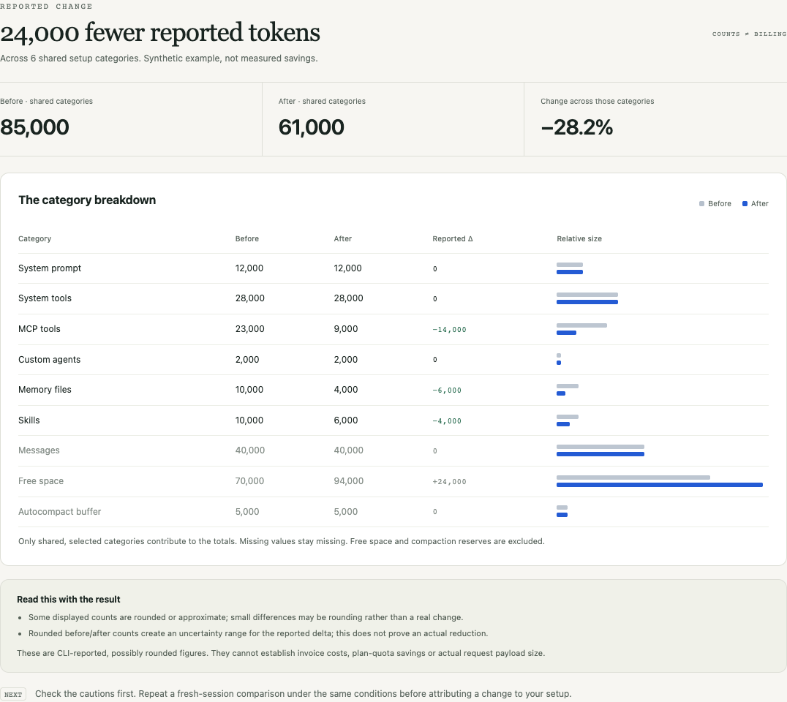

# Context Compare

**Did trimming your Claude Code setup change its reported context?**

Paste two `/context` summaries. Compare shared categories, spot missing or inconsistent data, and export a share card **with the cautions attached**.

[**Open the tool →**](https://gauravsinghbitmesra-design.github.io/context-compare/) · [Formats and examples](docs/formats.md) · [Why this exists](docs/research.md)

[](https://github.com/gauravsinghbitmesra-design/context-compare/actions/workflows/test.yml)
[](LICENSE)



## Try it in 30 seconds

1. [Open the live page](https://gauravsinghbitmesra-design.github.io/context-compare/). It starts with a clearly labeled synthetic example.
2. Try **No change** or **Missing data** to see how the result behaves.
3. For your own comparison, paste two category summaries and click **Compare snapshots**.
4. Copy Markdown, export aggregate JSON, or download a PNG card. Exports include the relevant limitations.

**No install, account, model API or API key.** The app processes pasted text locally in your browser. It does not upload input, call a model, store input, modify agent settings or read your session files. The hosted page still fetches its own static files normally; use the clone locally if you prefer. See [privacy](docs/privacy.md).

## A useful before/after test

Run `/context` in a fresh Claude Code session. Copy its top-level category summary. Review one setup choice, then start another fresh session with the same model/version and repeat. Keep the workload comparable and check your workflow still works after any separate configuration change.

The default comparison includes shared **system prompt, system tools, MCP tools, custom agents, memory files and skills**. **Setup + messages** also includes shared message counts. Free space and the compaction buffer are never treated as consumed tokens.

Missing categories stay missing; they are not filled with zero. A larger model window, fewer conversation messages, source-reporting changes or rounded displays can all affect interpretation. A same-conditions checkbox records your confirmation; this tool cannot verify it.

## What this can establish

It compares **reported category counts**, not independently measured request tokens, invoices, remaining plan limits or performance. `k`/`m` values are treated as rounded displays. The JSON/Markdown report includes a range for the delta based on that display precision; source-accounting errors can be larger than rounding alone.

Claude Code already has native usage analysis. This is a focused before/after check, not a replacement for `/usage` or a promise of lower costs. Upstream reports have described category-attribution errors; treat a pretty chart as a comparison of observations, not proof the source accounting is correct. See [measurement limits](docs/measurement.md) and the [official guidance](https://code.claude.com/docs/en/costs#reduce-mcp-server-overhead).

## Supported inputs

- Recognized colon/space category lines such as `System prompt: 12k tokens`.
- Markdown/box summary tables headed **Category / Tokens**.
- [Documented snapshot JSON](docs/formats.md), including explicit zeros and optional totals/capacity.

Not every Claude release or terminal rendering uses the same format. Unsupported lines produce a count-only caution. Duplicate categories or invalid known counts are errors; the app does not guess. Per-file/per-tool detail tables are excluded. Maximum 64 KiB and 1,000 lines per snapshot.

Codex and other tools can use the manual JSON format only when the categories have the same meaning. There is no automatic Codex integration or cross-provider cost comparison.

## Run locally

Download the repository and open **index.html**, or:

```sh
git clone https://github.com/gauravsinghbitmesra-design/context-compare.git
cd context-compare
python3 -m http.server 4173 --bind 127.0.0.1
```

Visit `http://127.0.0.1:4173`. Windows can use `py -3` instead of `python3`. The app itself requires no Python or Node runtime when opened directly or hosted. Clipboard behavior may differ on `file:` pages; localhost/HTTPS is preferred for Copy report. Downloads work without clipboard access.

Node users can run `npm start` with the included local-only server; no dependency installation is required to serve the app.

## Develop and verify

Node 22 or 24:

```sh
npm ci
npm test
npx playwright install chromium
npm run test:browser
```

The only npm dependency is for development/browser tests. There are no browser runtime packages, external fonts, CDNs or analytics. Pure parser/comparison tests run on Linux/macOS/Windows. Browser tests cover flows, exports, stale results, malicious input, no network calls after page load, no browser storage, mobile layout and direct-file use. See [validation](docs/validation.md).

[AGENTS.md](AGENTS.md), [CLAUDE.md](CLAUDE.md) and [PROMPT.md](PROMPT.md) provide the same workflow for local coding agents. Do not paste session transcripts or credentials into a public issue; share a minimal synthetic reproduction instead.

## How it differs

General context dashboards, usage monitors and native agent features already exist. Context Compare focuses on one small workflow: **two snapshots → a cautious comparison → a portable result**. It does not estimate model prices, proxy requests, launch agents or install hooks. Existing alternatives and evidence are credited in [research](docs/research.md); no third-party application code is bundled.

## Feedback and launch kit

Found a summary this cannot parse? [Open an issue](https://github.com/gauravsinghbitmesra-design/context-compare/issues/new/choose) with a redacted or synthetic category summary. A parser fix is more useful than another unsupported-format guess.

The [launch kit](launch/README.md) includes an X post, community-specific Reddit drafts, a short synthetic demo recording and relevant discussion links. Those are prepared materials, not a claim they have been posted or that any community permits promotion.

If the comparison was useful, a star helps others find it. Forks and small tested improvements are welcome. [MIT licensed](LICENSE).
